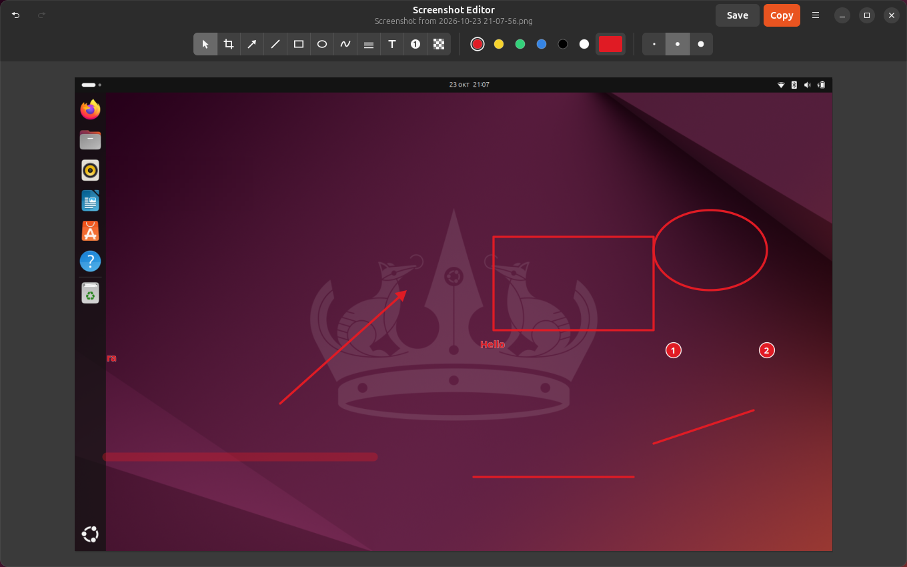

# Screenshot Editor for GNOME Shell

Take a screenshot the normal GNOME way (Print, or the screenshot button in
the top-bar menu) and an annotation editor opens on it: arrows, shapes, text,
step numbers, highlighter, blur and crop. Copy the result to the clipboard
or save it next to the original. GNOME's own shortcut and screenshot UI stay
exactly as they are.



## Requirements

- GNOME Shell 46 on Wayland (tested on Ubuntu 24.04)
- `gjs`, GTK 4 and libadwaita 1.5 GObject introspection data. On Ubuntu:
  `sudo apt install gjs gir1.2-gtk-4.0 gir1.2-adw-1`
- Optional: `wl-clipboard`, used for Copy if the extension is not running

## How it hooks in

A small GNOME Shell extension listens to the `screenshot-taken` signal of
`Main.screenshotUI`. GNOME emits it after the PNG is saved to
`~/Pictures/Screenshots` and copied to the clipboard. GNOME's screenshot code
is not patched; the extension launches the editor (a separate GTK4 /
libadwaita process in `extension/editor/`) on the saved file.

GNOME also shows a "Screenshot captured" notification, whose banner would
cover the editor's Copy and Save buttons. For screenshots that open in the
editor, the extension withdraws it in its `screenshot-taken` handler, a few
milliseconds after GNOME adds it and before the banner slides in. Saving from the editor shows a "Screenshot saved"
notification instead, with a thumbnail and Show in Files. Screenshots that do
not open the editor keep GNOME's notification.

| Screenshot method | Opens the editor |
| --- | --- |
| Print, or the quick-settings screenshot button | yes |
| Shift+Print, Alt+Print (direct screen/window capture) | no |
| Portal screenshots requested by other apps | no |

The portal reuses the same UI, so the extension checks the private
`screenshotUI._currentMode` and only reacts to the plain screenshot mode.

The extension also exports a D-Bus service for the editor,
`info.katsarov.ScreenshotEditor.Shell` on `/info/katsarov/ScreenshotEditor/Shell`:

- `CopyImage(ay png)`, for Copy. It validates the PNG signature and a 64 MiB
  size limit, then puts the image on the clipboard through `St.Clipboard`,
  like GNOME's own screenshot code does. Because the shell owns the clipboard
  content, the copy survives closing the editor.
- `ClaimScreenshot(s path) → b`: whether the extension just opened this file
  in the editor (see Keep Screenshot Files below).
- `NotifySaved(s path)`, for Save: shows the "Screenshot saved" notification.
  It is a shell notification, so it stays when Save also closes the editor.
  Without the extension, the editor shows an in-window message instead.

## Install and uninstall

```sh
git clone https://github.com/katsar0v/gnome-screenshot-editor.git
cd gnome-screenshot-editor
./install.sh              # symlink the extension, generate the .desktop file
./install.sh --uninstall  # disable, remove the symlink and the .desktop file
```

`install.sh` links `extension/` to
`~/.local/share/gnome-shell/extensions/screenshot-editor@katsarov.info` and
writes `~/.local/share/applications/info.katsarov.ScreenshotEditor.desktop`
pointing at the editor in this checkout (so keep the checkout where it is).
It does not enable anything. On Wayland, log out and back in once so GNOME
Shell discovers the extension, then:

```sh
gnome-extensions enable screenshot-editor@katsarov.info
```

## Settings

Open them from the editor's menu (**Preferences**), the Extensions app, or
`gnome-extensions prefs screenshot-editor@katsarov.info`.

| Setting | Default | What it does |
| --- | --- | --- |
| Open the Editor | on | Turn the editor off without disabling the extension. |
| Shutter Sound | on | Off mutes GNOME's screenshot sound for every screenshot, including Shift+Print and Alt+Print. Other system sounds are unaffected. |
| Keep Screenshot Files | on | Off: the screenshot is deleted from the Screenshots folder (and from recent files) when you close the editor without saving. Save then writes over GNOME's file instead of creating `-edited.png`. The copied image stays on the clipboard. |
| Close After Copying | off | Copy (Ctrl+C) also closes the editor. |

"Keep Screenshot Files" only applies to screenshots the extension itself opened
in the editor; an image you open by hand is never deleted. Shift+Print and
Alt+Print never open the editor, so GNOME keeps those files as usual.

From the command line:

```sh
gsettings --schemadir extension/schemas set org.gnome.shell.extensions.screenshot-editor play-sound false
```

## Development

Run the editor on its own (no shell needed):

```sh
gjs -m extension/editor/main.js path/to/screenshot.png
```

Test the extension in a nested shell, without touching your session. Run
`./install.sh` first (the nested shell is a new process, so it finds the
extension without a re-login):

```sh
dbus-run-session -- bash
GSETTINGS_BACKEND=memory gnome-shell --nested --wayland &
GSETTINGS_BACKEND=memory gnome-extensions enable screenshot-editor@katsarov.info
```

Trigger the hook by hand from Looking Glass (`Alt+F2`, `lg`, Evaluator tab):

```js
Main.screenshotUI.emit('screenshot-taken', Gio.File.new_for_path('/path/to/screenshot.png'))
```

Logs:

```sh
journalctl -f -o cat /usr/bin/gnome-shell
```

GNOME Shell on Wayland cannot reload JS modules. After changing
`extension/extension.js`, test in a nested shell or log out and in again. The
editor is a separate single-instance app (one window per screenshot); editor
changes apply once all its windows are closed.

Automated end-to-end test, in a throwaway headless GNOME Shell with its own
session bus, data and Pictures directory (your session is not touched):

```sh
tests/e2e/run.sh          # KEEP=1 keeps the temp dir with a screenshot per step
```

It presses Print, captures, draws with every main tool, checks Copy (including
after the editor closes), crop, Save, the close prompt, that GNOME's
notification is withdrawn only for screenshots that open the editor and Save
shows its own, that Shift+Print, Alt+Print and a real portal screenshot do not
open the editor, that disabling
the extension releases its D-Bus name, and every setting. Services the test
bus starts on demand (dconf, portals, the preferences window) also get the
test display and folders.

## Editor features

- Tools, each with a one-key shortcut: Select `V`, Crop `C`, Arrow `A`,
  Line `L`, Rectangle `R`, Ellipse `E`, Pen `P`, Highlighter `H`, Text `T`,
  Step number `N`, Blur/Pixelate `B`.
- Six preset colors plus a custom color; small / medium / large size. Sizes
  scale with the image, so marks look the same on 1080p and 4K screenshots.
  With a shape selected, picking a color or size restyles it.
- Shift while dragging: 45° lines and arrows, square rectangles and circles.
- Text: click to type, Enter to place, Esc to cancel; double-click a text with
  the Select tool to edit it. Step numbers renumber when one is deleted.
- Blur/Pixelate: toggle the mode in the tool bar. Blurred areas only sample
  the original screenshot and sit under all other annotations.
- Crop: drag, move or resize the frame, Enter (or Apply) to crop, Esc to
  cancel. Crop is undoable and keeps annotations outside the frame.
- Select: drag to move, Delete to remove, Esc to deselect.
- Undo `Ctrl+Z`, redo `Ctrl+Shift+Z` or `Ctrl+Y`.
- Copy `Ctrl+C`. The image goes through the extension's D-Bus `CopyImage`, so
  it stays on the clipboard after the editor closes. Fallbacks: `wl-copy`,
  then the GTK clipboard.
- Save `Ctrl+S` writes `<name>-edited.png` next to the original. The first
  save picks a free name (`-edited`, `-edited-1`, ...); later saves from the
  same window overwrite that file. Save As is `Ctrl+Shift+S`. Each save shows
  a "Screenshot saved" notification; click it to open the image.
- Close `Ctrl+W`, with a prompt if there are unsaved annotations.

GNOME has already put the unedited screenshot on the clipboard when the editor
opens; Copy replaces it with the annotated image.

## Notes

This is not published on extensions.gnome.org: the extension starts a bundled
application and reads the private `screenshotUI._currentMode`, which the
review guidelines discourage. Install it from this repository instead. If a GNOME update removes that field, the
extension logs one warning and opens the editor for portal screenshots too.

The extension only declares the default `user` session mode, so it is inactive
on the lock screen.

## Troubleshooting

- **Extension not listed:** on Wayland, log out and back in after the first
  install. Check `gnome-extensions list | grep screenshot` and that
  `gsettings get org.gnome.shell allow-extension-installation` is `true` and
  `disable-user-extensions` is `false`.
- **State ERROR in `gnome-extensions info screenshot-editor@katsarov.info`:**
  read the shell log (see above) for the exception.
- **Nothing opens after Print:** check the extension is enabled, then run
  `gjs -m extension/editor/main.js <png>` to see editor errors in the terminal.
  Screenshots from Shift+Print, Alt+Print and portals are ignored by design.
- **Editor opens but is not focused (a "ready" notification appears):** the
  desktop file is missing, so the extension used the plain `gjs` fallback,
  which carries no Wayland activation token. Run `./install.sh`.
- **Editor does not start from the desktop file:** the checkout was moved.
  Re-run `./install.sh` to regenerate the `.desktop` file.
- **Copy does not survive closing the editor:** the shell service is not
  reachable, so the editor used `wl-copy` or the GTK clipboard. Check
  `gdbus introspect --session --dest info.katsarov.ScreenshotEditor.Shell --object-path /info/katsarov/ScreenshotEditor/Shell`.
- **Settings have no effect / Preferences does not open:** run `./install.sh`
  again (it compiles the settings schema), then log out and back in.
- **After a GNOME upgrade:** add the new version to `shell-version` in
  `extension/metadata.json` and re-check the `screenshot-taken` signal and
  `_currentMode` in the new `screenshot.js`.

## License

GPL-2.0-or-later, the same license as GNOME Shell. See [LICENSE](LICENSE).
